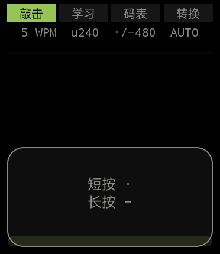
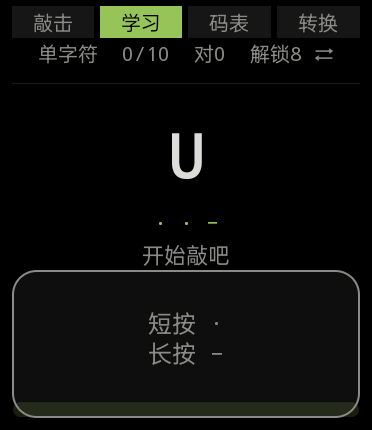
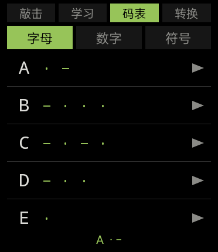
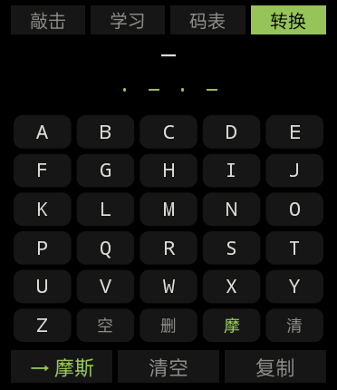

# WearMos

**用敲击表盘学摩斯电码。**

OPPO Watch 端的原生 Android 应用。整块表盘就是电键——短按为点、长按为划，停手即自动成字。
零第三方依赖，手写 View UI，单个 APK 同时适配方表与圆表。

<p align="center">
  
  
  
  
</p>

---

## 为什么做这个

学摩斯电码的常规路径是「看码表 → 背」。但摩斯本质上是一套**节奏**语言，
用眼睛背 `·−·` 只能记住形状，记不住手感。

手表恰好是这个场景的天然载体：戴在手腕上、随时可用、且只有一块够大的触摸面。
把整块表盘变成电键，敲击时手腕直接感受点划的长短比例——这是「听」和「看」都给不了的信息通道。

三个硬约束决定了整个技术选型：

- 目标设备内存只有 860MB，且被标记为 `ram.low` → **不能有 Compose、不能有 AndroidX**
- 设备只有 `armeabi-v7a` 32 位 ABI，且**无 GMS** → 纯表上独立运行，不依赖手机
- 表盘直径 466px，实际可用区域远小于屏幕矩形 → 布局必须按圆形几何算，不能按矩形

结果就是现在这样：无依赖、无网络、无后台，3550 行 Kotlin，88 个单元测试。

---

## 功能

### 敲击台 · 主屏

整屏即键控区，没有任何需要瞄准的按钮。

| 动作 | 行为 |
|---|---|
| 短按 | 记一个点 `·` |
| 长按 | 记一个划 `−` |
| 停手 ≥ 阈值 | 自动成字，点划序列解码后追加到文字行 |
| 继续停手 | 追加一个空格，准备下一个词 |
| 点击状态栏 | 切换 WPM 档位（5 / 8 / 10 / 12 / 16 / 20） |
| 长按状态栏 | 清空全部输入 |
| 点 ⌫ | 删除最后一个字符 |

底部有一条**脉冲条**，实时显示当前正在积累的点划序列——这是学习时最重要的反馈，
因为敲击过程中眼睛需要知道「我刚才敲的到底被算成了点还是划」。

### 学习 · Koch 顺序推进

按 Koch 方法的难度顺序逐字符解锁，从 `K` `M` 开始——这两个字符只差一个划的位置，
放在一起能最快建立「划的数量和位置决定字符」的直觉。

三种练习模式：

- **单字符** — 屏上给出目标字符和它的点划，跟着敲
- **听抄** — 只播节奏不给字符（长按可偷看答案），练耳朵
- **跟打** — 给出完整文本，连续敲击

答错时给出的是**橙色**反馈而非红色——手表屏小、近距离看，红色在学习场景里过重，
容易让人不想继续敲下去。

### 码表 · 对照与节奏演示

字母 / 数字 / 符号三页签，每行右侧有 `▶`，点击即按当前 WPM 播真实节奏（振动 + 声音）。
不查表、不背形状，直接听这个字符的**节奏长什么样**。

### 转换 · 双向互转

- **文字 → 摩斯**：内置精简键盘（A–Z 26 键 + 空 / 删 / 摩 / 清），输入实时转成点划
- **摩斯 → 文字**：直接在表盘上敲，边敲边解码
- 底部三个操作键：切换方向、清空、复制结果

键盘是按**内接正方形**排布的——圆表上如果按全宽排五列，最左最右的键会掉到屏幕外的弧区里点不到。

---

## 判码规则

采用 PARIS 标准计时，单位时长 `u = 1200 / WPM` 毫秒。

| 元素 | 时长 |
|---|---|
| 点 | `1u` |
| 划 | `3u` |
| 字符内间隔（点划之间） | `1u` |
| **字符间间隔（成字阈值）** | `3u` |
| 词间间隔 | `7u` |

解码链只有三层，从下往上依次判定：

```
按下时长 ──→ 点 / 划      （阈值 = 点划分界，启动时可自适应校准）
停手时长 ──→ 成字          （≥ 3u）
继续停手 ──→ 追加空格      （≥ 7u）
```

**注意成字阈值随 WPM 急剧变化**——这一点在初学时很关键：

| WPM | 单位 `u` | 成字阈值 `3u` |
|---|---|---|
| 5 | 240ms | **720ms** |
| 12 | 100ms | 300ms |
| 20 | 60ms | **180ms** |

20 WPM 下只有 180ms 的成字窗口，意味着敲完一个字符后必须在 0.18 秒内决定「下一个是什么」，
否则前一个字符就已经被提交了。初学者如果觉得「连着敲两个点被判成了别的字符」，多半是这个原因。

---

## 方表 / 圆表适配

判断依据是 `Configuration.isScreenRound`（对应 `DisplayInfo.FLAG_ROUND`），
而不是机型名或分辨率的宽高比——后者会把方形表盘的四角误判进去。

圆屏的核心几何是**弦长**：屏幕圆心 `(cx, cy)`、半径 `R`，屏幕上第 `y` 行能容纳的宽度是

```
width(y) = 2 · √(R² − (cy − y)²)
```

这个约束的威力在边缘行特别明显。以 466×466 的圆表为例：

| 行位置 `y` | 可用宽度 |
|---|---|
| 中心 | 466px |
| 上方 6px 处 | **约 105px** |
| 上方 36px 处 | 约 260px |

`y = 6` 时只剩 105px，而四个导航格至少需要 285px——
**方表上看起来正常的布局，直接搬到圆表上会让首尾两个导航格完全点不到。**

所以圆屏走的是另一条路：顶部留 26dp 硬内边距避开弧区，然后对每一行**按它实际所在的
纵向区段收窄宽度**。难点是线性布局的高度由 `weight` 分配，测量阶段还拿不到——
因此宽度校正在布局完成后用 `addOnLayoutChangeListener` 做，并靠
`View.tag` 存一个尺寸指纹做幂等哨兵，避免无限回调。

方屏则走短路：`isRound = false` 时 `widthAt()` 直接返回全宽，所有分支都不进入，
行为与没有做适配时**逐像素一致**。

唯一的例外是敲击台的全屏键控区：它**不做宽度收窄**，而是把自己绘制成
`圆角矩形 ∩ 屏幕圆` 的交集（`Path.op(INTERSECT)`）。因为它的语义就是「整块屏幕」，
收窄反而会让边缘区域变得不可点。

---

## 构建

环境要求：**JDK 17+**（Gradle 9.0.0 需要）。AGP 8.13.0 + Kotlin 2.2.0，Gradle wrapper 已固定为 9.0.0。

```bash
# 1. 指向本机 Android SDK
echo "sdk.dir=$HOME/Library/Android/sdk" > local.properties

# 2. 构建
./gradlew assembleDebug
```

产物：`app/build/outputs/apk/debug/app-debug.apk`（约 2.7 MB）

安装到手表（需先在开发者选项里打开 ADB 调试，并让手表与电脑在同一 Wi-Fi 或通过 USB 连接）：

```bash
adb install -r app/build/outputs/apk/debug/app-debug.apk
# 或以敲击台为主入口直接拉起
adb shell am start -n com.wearmos/.ui.KeyerActivity
```

跑测试：

```bash
./gradlew test
```

> 若在 JDK 25 上构建，请确认使用 Gradle 9.0.0。Gradle 8.x 内嵌的 Kotlin
> 无法解析 `"25.0.x"` 版本号，会在初始化阶段直接抛 `IllegalArgumentException`。

---

## 项目结构

```
app/src/main/java/com/wearmos/
├── core/
│   ├── DisplayGeometry.kt      圆/方几何：弦长计算、内接方、dp 换算
│   ├── MorseCodec.kt           文本 ⇄ 摩斯编码解码
│   ├── MorseTable.kt           字符表（字母 / 数字 / 标点）
│   ├── KeyerStateMachine.kt    敲击状态机：点划累积 → 成字 → 空格
│   ├── AdaptiveThreshold.kt    点划分界阈值，按实际敲击时长自适应
│   ├── Timing.kt               PARIS 计时模型（含 Farnsworth 支持）
│   ├── DemoTimeline.kt         把点划序列展开成带时间戳的播放时间线
│   └── KeyEvent.kt
├── ui/
│   ├── KeyerActivity.kt        敲击台
│   ├── LearnActivity.kt        学习
│   ├── ReferenceActivity.kt    码表
│   ├── ConvertActivity.kt      转换
│   ├── KeyerScreen.kt          四屏共用的基类：计时、触觉、状态机装配
│   ├── UiKit.kt                配色 / 字号 / 导航条 / 圆屏收窄等共用件
│   └── view/
│       ├── MorseKeyView.kt     全屏键控区（触摸判定 + 交集绘制）
│       ├── PulseStripView.kt   脉冲条
│       ├── KeyboardView.kt     精简键盘（内接正方形排布）
│       ├── MorseRowView.kt     码表行
│       └── SegmentedBar.kt     分段选择器
├── learn/                      Koch 顺序、关卡定义、题库、课程引擎
├── input/TapSource.kt          触摸/按键事件源
├── feedback/                   振动引擎、节奏播放器
└── data/                       SharedPreferences 持久化（进度 / 设置）
```

UI 全部是手写的 `View`，没有 XML 布局文件、没有 Compose。所有 `Text` 都是代码里直接创建的
——四张屏的结构差异不大，用 XML 反而要多维护一套命名和引用。

---

## 测试

**88 个单元测试**，全部为纯逻辑测试，不需要设备或模拟器：

| 测试文件 | 数量 | 覆盖 |
|---|---|---|
| `LessonEngineTest` | 25 | 课程推进、解锁条件、判分 |
| `KeyerStateMachineTest` | 19 | 点划累积、成字、空格、退格 |
| `DisplayGeometryTest` | 15 | 弦长 / 带高 / 内接方（钉死 372×430 与 466×466 的真实数值） |
| `DemoTimelineTest` | 12 | 节奏时间线展开 |
| `DrillBankTest` | 9 | 题库出题与去重 |
| `MorseCodecTest` | 8 | 编解码往返、非法输入 |

`DisplayGeometryTest` 用的是两台真机实测的分辨率与密度（372×430 / 320dpi、
466×466 / 320dpi），而不是构造出来的整数——这样圆屏的边界行为才有参考价值。

---

## 已验证 / 未验证

坦率地区分一下，避免误导：

**真机验证过**（OWW212，方表，Android 11 / API 30）
- 敲击解码全链路：点划识别 → 成字 → 文字行追加
- 删除键：⌫ 字形渲染正常、点击命中、与键控区间距 10dp 无误触
- 布局数值：文字行 `12,205–360,241`，键控区顶边 `261`，实际间距 20px = 10dp

**仅逻辑与单元测试验证**
- 圆表（OPWW234）布局：几何计算有 15 个测试覆盖，四个导航格的可点性**尚未在真机上实测**
- `⌫` (U+232B) 的字体覆盖：通过解析系统字体 `cmap` 表 + 检查 `fonts.xml` 兜底链确认
  （该字符不在 OPlusSans3 / Roboto / DroidSans 中，由 NotoSansSymbols 兜底），
  并在方表上确认无豆腐块。圆表机型字体集可能不同。
- 侧键 `KEYCODE_STEM_PRIMARY` 退格：代码已接，未在设备上验证

---

## 已知限制

- **Farnsworth 间隔法尚未启用**。`MorseTiming` 已支持 `charWpm ≠ effectiveWpm`
  （点划长度按前者、间隔按后者），但 `applyTiming()` 目前传入的是 `MorseTiming(wpm, wpm)`，
  所以两档始终相同。这是初学者「连续敲两个点被判成一个划」问题最直接的解法，留待后续。
- **自适应只作用于点划分界，不作用于间隔**。`AdaptiveGapPolicy` 从按键时长反推单位时长，
  它不观察实际的停手时长，因此对「停手太短导致提前成字」无能为力。
- **字符内间隔没有独立判定**。`intraCharGapMs` 是已定义但未被读取的常量——
  点划之间的间隔不做单独检测，它的语义只是「还没到成字阈值」。
- 声音播放已实现但主屏未接入（振动反馈已完整）。设备扬声器在手腕上音量有限，
  实际学习时振动比声音更可靠。

---

## 许可

未指定许可证。如需使用请先开 issue 联系。
